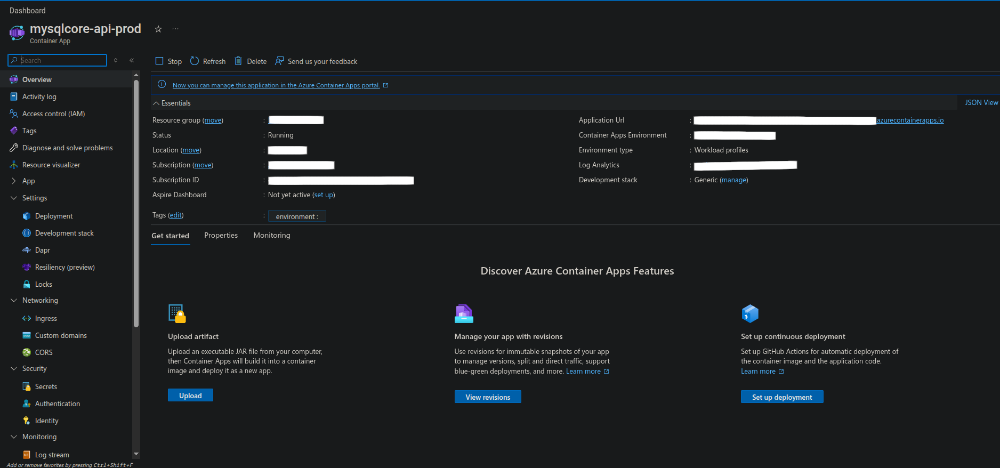
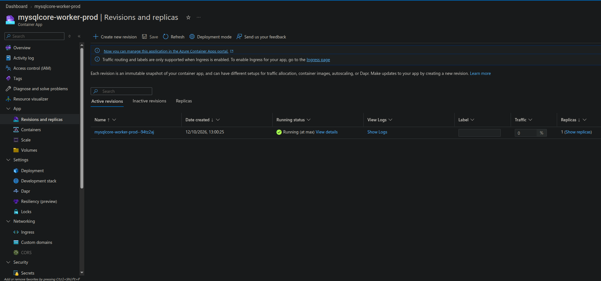
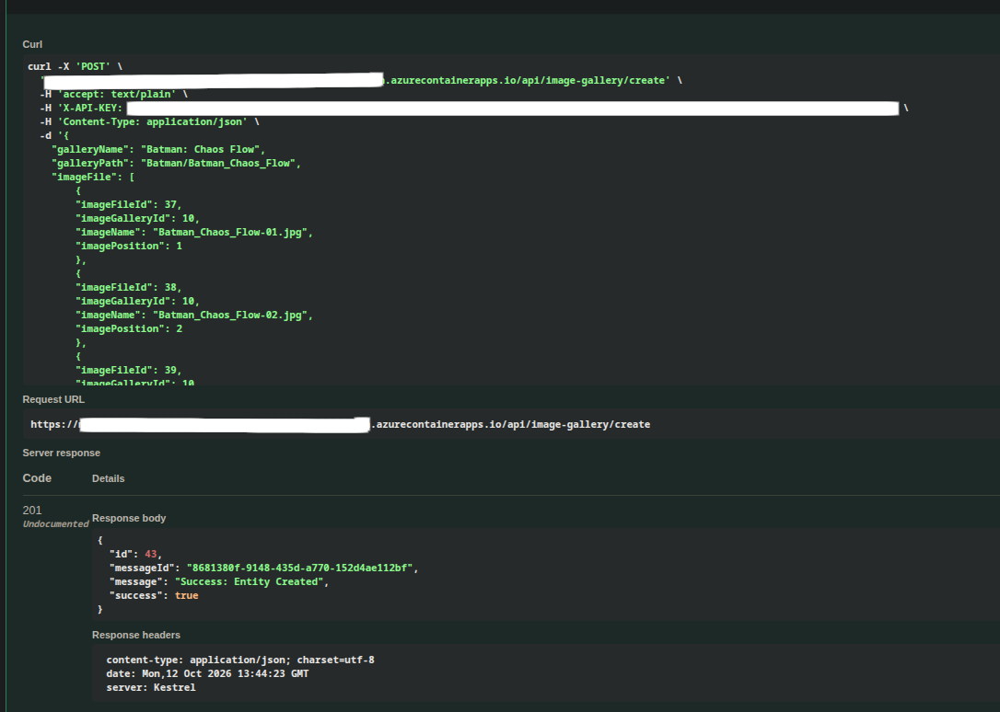
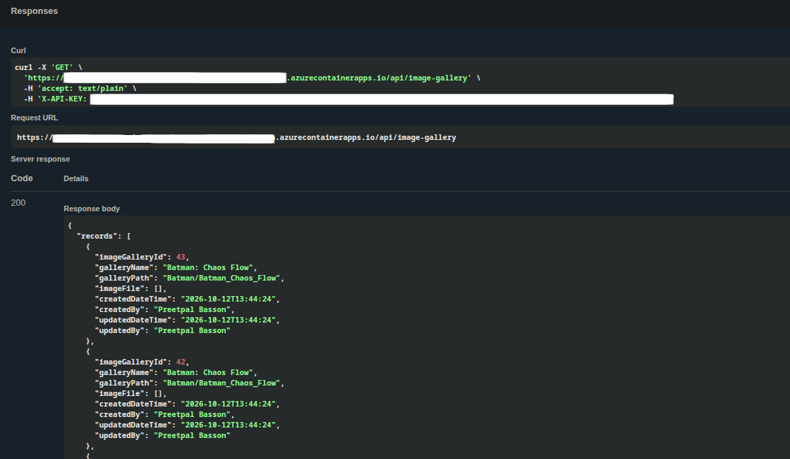
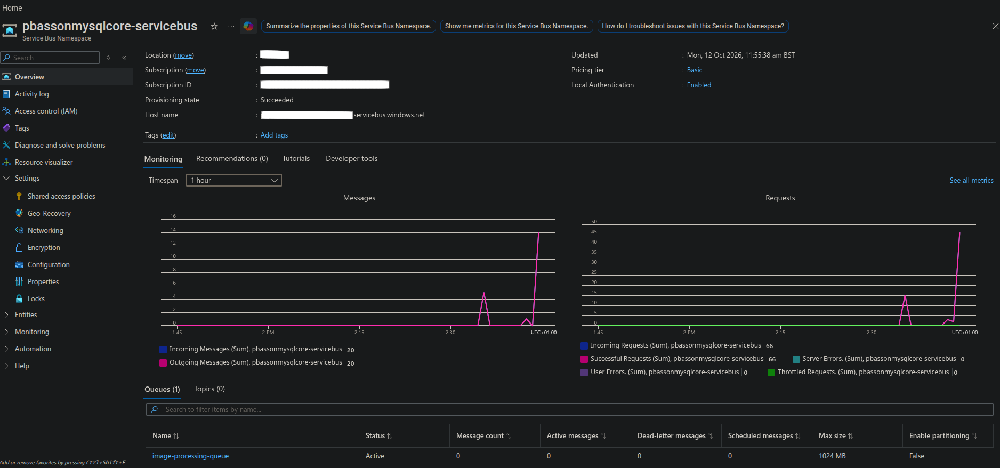
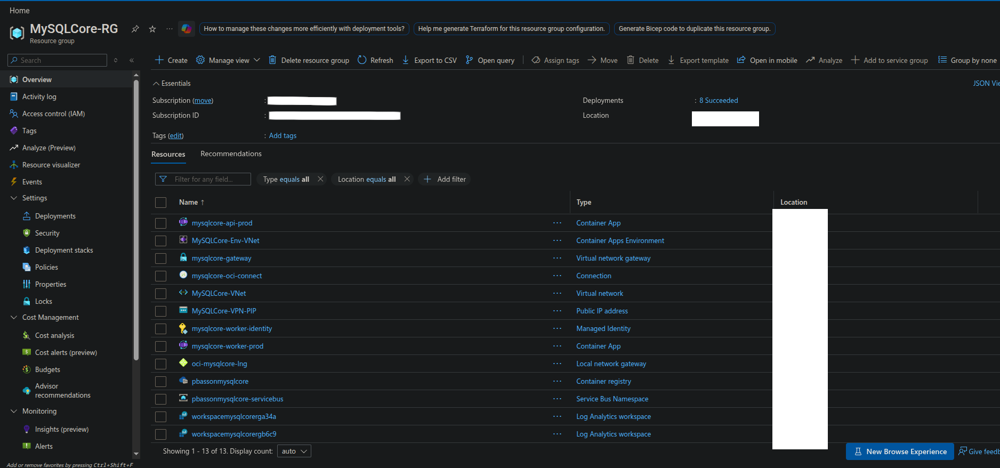

# MySQLCore

MySQLCore is a backend demo project showing how to build a layered ASP.NET Core REST API backed by MySQL, with RabbitMQ or Azure Service Bus messaging, outbox-based background processing, Redis caching, structured logging, distributed tracing, metrics, containerized infrastructure, and test coverage across the main application layers.

## What This Demo Shows

- A REST API for user and image gallery data.
- A one-to-many image gallery workflow using gallery records and related image files.
- Clean separation between API, Core, Infrastructure, and Worker projects.
- Repository and service layers for data access and business logic.
- MySQL persistence through Entity Framework Core.
- Redis-backed caching through the ASP.NET Core distributed cache abstraction.
- Configuration-selected RabbitMQ or Azure Service Bus publishing and background message processing.
- Outbox message storage and publishing for more reliable asynchronous work.
- Processed message tracking for image-created events.
- API endpoints for users, image galleries, outbox, and processed message data.
- API key middleware and Swagger security configuration.
- Global exception handling middleware.
- Structured application logging with Serilog and Seq.
- OpenTelemetry tracing exported through the OTLP collector.
- Prometheus metrics for the API and worker process.
- Grafana, Tempo, Prometheus, Seq, RabbitMQ, Redis, and MySQL infrastructure support.
- Docker Compose setup for the full local stack.
- Kubernetes manifests for backend, worker, database, middleware, and observability services.
- SQL scripts for database and table creation/removal.
- Unit test projects for API, Core, and Infrastructure behavior.

## Technology

| Area | Technology |
|---|---|
| Runtime | .NET 8.0 |
| Language | C# |
| API | ASP.NET Core Web API |
| Worker | .NET Worker Service |
| Database | MySQL 8 |
| Data access | Entity Framework Core, Pomelo MySQL provider, MySqlConnector |
| Cache | Redis, StackExchangeRedis distributed cache |
| Messaging | RabbitMQ, Azure Service Bus |
| Background processing | Hosted services, dedicated worker process |
| Message reliability | Outbox pattern, processed message tracking |
| Validation | FluentValidation |
| API documentation | Swagger / OpenAPI |
| Security | API key middleware |
| Logging | Serilog, Seq, rolling file logs |
| Tracing | OpenTelemetry, OTLP collector, Tempo |
| Metrics | prometheus-net, Prometheus, Grafana |
| Containers | Docker, Docker Compose |
| Orchestration | Kubernetes |
| Testing | xUnit, Moq, AutoFixture, EF Core InMemory, coverlet |
| CI | GitHub Actions |

## Solution Structure

```text
src/
  MySQLCore.API             ASP.NET Core API, controllers, middleware, security, configuration
  MySQLCore.Core            DTOs, interfaces, services, validators, messages, constants, shared models
  MySQLCore.Infrastructure  EF Core DbContext, entities, repositories, factories, Redis services

worker/
  MySQLCore.Worker          Outbox publishing, RabbitMQ/Azure Service Bus clients, image message processing

test/
  MySQLCore.API.Test
  MySQLCore.Core.Test
  MySQLCore.Infrastructure.Test
  MySQLCore.Messaging.IntegrationTest

data/                       SQL database and table scripts
configurations/             Prometheus, Tempo, and OpenTelemetry collector configuration
kubernetes/                 Kubernetes manifests for app, middleware, database, and observability services
scripts/                    Docker and Kubernetes command notes
```

## Main API Areas

### UserController

Demonstrates standard CRUD operations for user records:

- Get the latest records.
- Get paged records.
- Get a record by ID.
- Create a record.
- Update a record.
- Delete a record.

### ImageGalleryController

Demonstrates an image gallery workflow with related image files:

- Manage image gallery records.
- Return related image files through detail and paged queries.
- Create image gallery data with an outbox message for asynchronous processing.
- Work with the messaging flow through the core service layer.

### OutboxMessagerController

Shows the current state of messages waiting to be published or recently published:

- Get pending outbox messages.
- Get the latest published message.
- Get a single outbox message by ID.

### ProcessedMessageController

Shows the result of messages handled by the worker process:

- Get a processed message by ID.
- Get the latest processed messages.

## Messaging Flow

The project uses an outbox table for image gallery events, with RabbitMQ or Azure Service Bus selected through `Messaging:Provider`.

The API saves gallery changes and their outbox message in the same MySQL transaction. `OutboxWorker` reads pending messages and publishes them through the selected provider. `RabbitMQImageWorker` or `AzureServiceBusImageWorker` consumes the messages through `ProcessWorkerService`, with processed-message tracking and duplicate detection. The Azure consumer completes successful or duplicate deliveries, dead-letters invalid payloads, and abandons processing failures for redelivery subject to the queue's delivery limit.

## Observability

The project includes a small observability stack so the backend can be inspected beyond basic console output:

- Serilog writes structured logs to the console, files, and Seq.
- The API exposes Prometheus metrics through `/metrics`.
- The worker exposes Prometheus metrics on its own metric server.
- OpenTelemetry tracing is exported to the OTLP collector.
- Tempo stores traces and Grafana can be used to inspect metrics and traces.

## Azure Deployment Demonstration

MySQLCore was deployed to Azure Container Apps as separate ASP.NET Core API and .NET background worker applications, with Azure Container Registry for Docker images, Azure Service Bus for asynchronous messaging, and existing MySQL database infrastructure for persistence.

The worker's Service Bus client uses `DefaultAzureCredential`, supporting Azure Managed Identity authentication with Azure RBAC permissions for sending and receiving messages.

### Deployment Evidence

The supplied screenshots capture the demonstration on 12 October 2026.

**API deployment:** Azure Container Apps shows the API application in the Running state.



**Worker deployment:** An active worker revision is running with one replica.



**API creation — HTTP 201:** `POST /api/image-gallery/create` returns a successful creation response with a gallery ID and message ID.



**API retrieval — HTTP 200:** `GET /api/image-gallery` returns gallery records, including the ID from the creation response.



**Service Bus activity:** The displayed one-hour window records 20 incoming and 20 outgoing messages. The queue is Active, with zero active (pending), dead-letter, or scheduled messages at capture time. These metrics demonstrate messaging activity; an empty queue alone does not prove successful application processing.



**Azure infrastructure:** The resource-group overview shows the API and worker Container Apps, Container Apps environment, container registry, Service Bus namespace, managed identity, networking resources, and Log Analytics workspaces.



### Demonstration Lifecycle

Azure resources were provisioned for a practical cloud integration demonstration and are intended to be decommissioned after verification to avoid ongoing cloud costs. The source code, deployment configurations, and screenshots remain available for reference after shutdown.

## Notes

- Environment-specific values are kept outside the main project files.
- SQL setup and teardown scripts are kept under `data/`.
- Docker Compose and Kubernetes files are included, but setup steps are intentionally not documented here.
- The API is configured for Swagger/OpenAPI and API key authentication.
- Docker image build automation is included through GitHub Actions.
